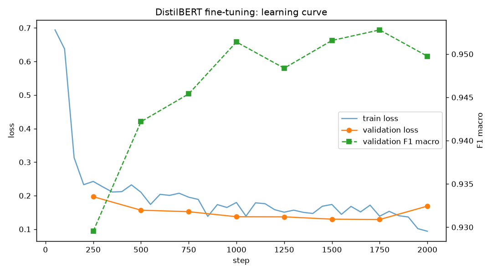

# Sentiment Analysis API

A fine-tuned **DistilBERT** classifier for product-review sentiment, served by **FastAPI** with
rate limiting, optional API-key auth, structured logging, Prometheus metrics, drift detection,
and a CI/CD path to a live container. It covers the full model lifecycle, from ingestion to serving and back.

```
Data ──▶ Train ──▶ Sweep ──▶ Artefact ──▶ Serve ──▶ Monitor
 ▲      (T4, ~2.5h) (W&B bayes)  (W&B / HF)  (Docker)  (Prometheus + Evidently)
 └──────────────────── drift detected → retrain ◀──────────────┘
```

**Stack:** Python 3.11 · PyTorch · Hugging Face Transformers · FastAPI + Uvicorn · slowapi ·
Prometheus + Grafana · Evidently AI · Weights & Biases · Docker → GHCR → Railway · GitHub Actions

---

## Results

Fine-tuned from `distilbert-base-uncased` on 60,000 Amazon product reviews (`fancyzhx/amazon_polarity`),
on an Apple M4 GPU. These scores come from 10,000 held-out test reviews, evaluated once after training:

| Metric | Result | Acceptance gate | |
|---|---|---|---|
| Accuracy | **94.97%** | ≥ 92% | ✅ |
| F1 macro | **94.97%** | ≥ 91% | ✅ |
| ROC-AUC | **98.68%** | ≥ 95% | ✅ |



Validation ran every 250 steps (about 8,000 reviews), with a checkpoint saved each time. Validation loss
fell steadily to **0.129 at step 1750**. At step 2000, the first checkpoint of epoch 2, training loss kept
falling (0.14 → 0.09) while validation loss jumped 31% to 0.169. That's overfitting, so the guard stopped
training with 1,750 of 3,750 steps unused, and the **step-1750 checkpoint** was kept. The full run record
is in [`docs/metrics.json`](docs/metrics.json).

| Review | Prediction |
|---|---|
| Best product I have ever bought! | POSITIVE 0.994 |
| This is **not** what I would call a good product. | NEGATIVE 0.990 |
| Arrived on time and looks nice, **but** the battery dies in an hour. | NEGATIVE 0.903 |
| Oh **great**, another charger that stopped working after a week. | NEGATIVE 0.973 |

---

## ReviewPulse platform (branch `platform`)

The sentiment API is growing into **ReviewPulse**, a self-serve review-intelligence platform for brands.
Requirements: [`docs/REQUIREMENTS.md`](docs/REQUIREMENTS.md).

```bash
# backend: FastAPI with the /v1 platform API (SQLite by default; DATABASE_URL for Postgres)
make run                                   # http://localhost:8000

# website: Next.js marketing site + dashboard, proxies /v1 to the backend
cd web && npm install && npm run dev       # http://localhost:3000
```

| Area | Status |
|---|---|
| Accounts, organizations, sessions, self-serve API keys (hashed), plans, quotas, per-plan rate limits | ✅ |
| Products, logged product changes, review push + CSV/JSON upload with de-duplication and personal-data removal | ✅ |
| Website: home, pricing, docs, signup/login, dashboard, products, reviews, changes, API keys, settings | ✅ |
| Analysis engine: clause sentiment (our DistilBERT), aspects, discovered specific issues, star-rating impact ranking | ✅ |
| Fix verification (logistic regression, trend-aware, placebo check) and early warning (binomial test vs 8-week baseline) | ✅ |
| Background analyses, quick/full reports API, Insights dashboard | ✅ |
| Two account types with separate logins: personal (research, 10/day free) and business (products, reports) | ✅ |
| Personal research: product link or name → reviews from permitted sources → summary, pros/cons, top-3 alternatives | ✅ (web needs `FIRECRAWL_API_KEY`) |
| Business PDF report: every aspect, quotes, fix verification with charts, warnings, sources, method | ✅ |
| PostgreSQL with Alembic migrations (`make migrate`) | ✅ |
| Sources: Apple App Store (live), web via Firecrawl | ✅ |
| YouTube and Reddit connectors, webhooks, email, scheduled refresh, payments | Next |

**Measured** (`python -m scripts.simulate_stats`, 300 simulations each): fix verification detects a real 30% reduction
80% of the time with 900 reviews, with a ~6% false-positive rate when nothing changed. A steady decline that was
already underway can still be credited to a change (~21%), so every verdict is shown next to its weekly chart.
Early warning catches a 3× jump in complaints 83% of the time about one week in, with false alarms in ~7% of stable
histories.

**Try it with real data:** `python -m scripts.seed_demo` loads two Amazon Reviews 2023 products into
`demo@example.com` / `demo-password-123`.

---

## Quick start

```bash
python -m venv .venv && source .venv/bin/activate      # Windows: .venv\Scripts\activate
make install                     # CPU torch + app + dev tools
pip install datasets             # only needed by the next step's drift baseline
make model                       # put a servable checkpoint into models/distilbert-sentiment/
make run                         # http://localhost:8000/docs
```

You need a model in `models/distilbert-sentiment/` before the API can start. There are three ways to get one:

- **Train it** with `python -m scripts.train` (see [Training](#training)). This produces the model in the [Results](#results).
- **Pull a trained one:** `python -m scripts.download_model --hub <user>/<repo>` or `--wandb <artifact>`.
- **Quick start:** `make model` with no arguments fetches the public
  `distilbert-base-uncased-finetuned-sst-2-english` checkpoint. It's trained on movie-review sentences, not
  product reviews, but it lets the API run in a minute.

```bash
curl -X POST http://localhost:8000/api/v1/predict \
  -H "Content-Type: application/json" \
  -d '{"text": "Best product I have ever bought!", "return_probabilities": true}'
```

```json
{
  "label": "POSITIVE",
  "confidence": 0.994211,
  "probabilities": {"NEGATIVE": 0.005789, "POSITIVE": 0.994211},
  "text": "Best product I have ever bought!",
  "latency_ms": 7.3,
  "request_id": "e8099c03b1814b0d994c9f716ac2ff49"
}
```

---

## API

| Method | Endpoint | Purpose |
|---|---|---|
| `POST` | `/api/v1/predict` | One text → label + confidence (`return_probabilities` for the full distribution) |
| `POST` | `/api/v1/batch` | Up to 32 texts (`INFERENCE_BATCH_SIZE`) scored in **one forward pass** |
| `POST` | `/api/v1/jobs/batch` | Up to 1,000 texts as a background job → `202 Accepted` + `job_id` |
| `GET` | `/api/v1/jobs/{job_id}` | Poll status: `queued → running → complete` with `processed/total` |
| `GET` | `/api/v1/jobs/{job_id}/results` | Collect predictions (`409` until complete) |
| `GET` | `/api/v1/monitoring/drift` | Live PSI vs. training reference (length, confidence, label mix) |
| `GET` | `/health` · `/ready` | Liveness · readiness (`503` until the model is loaded) |
| `GET` | `/metrics` | Prometheus exposition, including custom ML metrics |
| `GET` | `/docs` | Swagger UI (generated from the Pydantic schemas) |

### Rate limits and auth

| Caller | Limit | Identified by |
|---|---|---|
| Anonymous | 60 req/min | client IP |
| With API key (`X-API-Key: …` or `Authorization: Bearer …`) | 300 req/min | the key |

Auth is optional by default. A **wrong** key always returns `401`. Set `REQUIRE_API_KEY=true` to make
keys mandatory; the middleware doesn't change. Responses carry `X-RateLimit-*` headers, and `429`s
carry `Retry-After`. Probes, `/metrics` and docs are never limited.

### Request path

```
Client ─▶ CORS ─▶ Rate limit ─▶ Request ID + JSON log ─▶ API key ─▶ Inference service ─▶ DistilBERT
                  (slowapi)                                          tokenize → batch → forward → softmax
```

All four layers are plain ASGI middleware (`app/core/middleware.py`). Rate limiting runs **before** auth
and inference, so a flood is rejected cheaply. A test verifies that a rejected request never reaches
the model (`tests/test_middleware.py::test_rate_limit_rejects_before_inference`).

### Python client

```python
import httpx, time

api = httpx.Client(base_url="http://localhost:8000", headers={"X-API-Key": "your-key"})
print(api.post("/api/v1/batch", json={"texts": ["Great product!", "Broke in a day."]}).json())

job = api.post("/api/v1/jobs/batch", json={"texts": reviews}).json()          # up to 1,000
while api.get(job["status_url"]).json()["status"] not in ("complete", "failed"):
    time.sleep(1)
results = api.get(job["results_url"]).json()["results"]
```

---

## Design decisions

| Decision | Why |
|---|---|
| **DistilBERT, not BERT** | 6 layers / ~66M params vs 12 / ~110M: about 40% smaller and 60% faster while keeping ~97% of BERT's language understanding. It runs a forward pass on every request, so speed matters more than the last few points of accuracy. |
| **Model loaded once in the lifespan hook** | Loading costs seconds and a forward pass costs milliseconds. `app/main.py` loads the model at startup, runs one warm-up pass, and shares it through `app.state`. Inference runs under `torch.inference_mode()`. |
| **Real batching** | `/batch` sends all texts through one padded forward pass. A test asserts the backend is called once (`test_batch_is_a_single_forward_pass`). |
| **Async jobs for big inputs** | 1,000 texts can outlive a proxy timeout. The job worker scores in chunks off the event loop, so `/predict` stays responsive. |
| **Forward passes serialized by a lock** | Fast tokenizers aren't thread-safe, and one pass at a time lets torch use every core for it. Concurrency comes from batching. |
| **Weights mounted, not baked in** | The image stays small, and a new checkpoint is a volume swap, not a rebuild. |

### Measured locally

Measured with `scripts/load_test.py` against the trained model, served on an Apple M4 (MacBook Air,
16 GB) GPU via MPS (`DEVICE=auto`). The rate limiter was off so the numbers reflect the model:

| Load | p50 | p95 | p99 | Throughput |
|---|---|---|---|---|
| `/predict`, 1 client | **7.3 ms** | 10.0 ms | 11.2 ms | 130 req/s |
| `/predict`, 8 concurrent clients | 58.6 ms | 132.6 ms | 136.2 ms | 111 req/s |
| `/batch` of 32 texts, 4 clients | 154 ms | 158 ms | 165 ms | **827 texts/s** |

Batching gives about 7× the texts/second of single calls. Under concurrency, single requests queue
behind each other, because forward passes are serialized. Numbers on a CPU-only container host will be
slower; run `make load-test` on your deployment and quote those. Anonymous callers hit the 60/min limiter
quickly, so pass `--api-key` or set `RATE_LIMIT_ENABLED=false` to measure raw capacity.

---

## Training

```bash
pip install -r requirements-train.txt
python -m scripts.train --fp16 --wandb --log_artifact                  # CUDA GPU, e.g. a Colab T4
python -m scripts.train --device mps --batch_size 16 --grad_accum 2     # Apple-silicon GPU (16 GB Mac)
python -m scripts.train --device mps --batch_size 16 --grad_accum 2 --resume   # continue after a crash
```

Or open **`notebooks/train_distilbert.ipynb`** in Colab (T4 runtime).

- **Data:** `fancyzhx/amazon_polarity`. The script uses 60k train and 5k validation rows carved disjointly
  from the train split, plus 10k test rows from the dataset's own test split. You can pass your own CSV with
  `--data_file reviews.csv` (`text,label`).
- **Leakage guard:** training rows whose text also appears in validation or test are dropped.
  Class balance is logged per split.
- **Optimisation:** AdamW with weight decay, linear warmup then decay, gradient clipping at 1.0.
- **Test set touched once**, after training. It's never used for model selection.
- **Acceptance gates:** accuracy ≥ 0.92, F1 macro ≥ 0.91, ROC-AUC ≥ 0.95 on the test set. If any gate
  fails, the checkpoint is **not written** and the script exits with code 1.
- **Outputs** in `models/distilbert-sentiment/`: weights, tokenizer, `metrics.json` (real test scores +
  gate results + hyperparameters + stop reason), `learning_curve.csv/.png`, `reference_stats.json` and
  `reference_sample.csv` (drift baselines).

### Training safety rails (`scripts/training_guard.py`)

| Rail | Behaviour |
|---|---|
| **GPU only** | `--device auto` picks CUDA or MPS and **refuses to run on CPU** unless `--device cpu` is explicit. `PYTORCH_ENABLE_MPS_FALLBACK=0` makes unsupported ops fail instead of silently running on the CPU. At step 0, every parameter tensor is checked to be on the GPU. (Apple's Neural Engine can't be used for PyTorch training; it only runs Core ML inference.) |
| **Overfitting guard** | Validates every `--eval_steps` (250). Stops immediately if validation loss jumps more than 5% above its best, if it fails to improve by more than 0.002 for `--patience` (2) evaluations, if validation F1 drops more than 1 point below its best, or if any loss becomes NaN or inf. |
| **Best weights kept** | Checkpoints are saved at every validation and selected by lowest validation loss, so the final model is the best checkpoint, never the over-trained last one. |
| **Crash-safe** | `--resume` continues from the latest checkpoint and restores the guard's history (best loss and patience count). The final model goes into a temp folder and is swapped in atomically; the previous model is kept as `models/distilbert-sentiment.previous`. |
| **Memory guard (Apple silicon)** | Hard GPU memory cap (`PYTORCH_MPS_HIGH_WATERMARK_RATIO=0.55`), cache release every 25 steps and after each validation, and padding to a multiple of 32 tokens. Without these, the MPS allocator reached 14 GB on a 16 GB Mac and pushed it into swap, slowing training about 20×. |
| **Learning curve** | Every train-loss log and validation result goes to `learning_curve.csv`, rendered to `learning_curve.png`. |

On a MacBook, keep the lid open while training: closing it sleeps the machine and pauses training, even
with `caffeinate`.

### Hyperparameter sweep

```bash
python -m scripts.sweep --count 10          # or: wandb sweep sweeps/sweep.yaml && wandb agent <id>
```

This is a Bayesian search over learning rate (log-uniform 1e-5 to 1e-4), batch size, warmup ratio, weight decay and
epochs, maximising **validation** F1 macro. Retrain the winning config with the gates enforced and
`--log_artifact`, then deploy it:

```bash
python -m scripts.download_model --wandb <entity>/<project>/distilbert-sentiment:latest
```

---

## Monitoring

```bash
make stack       # API :8000 · Prometheus :9090 · Grafana :3000 (admin/admin)
```

**Prometheus metrics** (`/metrics`):

| Metric | Type | What it tells you |
|---|---|---|
| `http_requests_total{method,path,status}` | counter | traffic and error rate per route |
| `http_request_duration_seconds` | histogram | p50/p95/p99 latency |
| `sentiment_predictions_total{label}` | counter | prediction mix; a sliding ratio is an early drift signal |
| `sentiment_prediction_confidence` | histogram | falling confidence means inputs the model hasn't seen |
| `sentiment_inference_duration_seconds` | histogram | model time, separate from HTTP overhead |
| `sentiment_inference_batch_size` | histogram | texts per forward pass |
| `sentiment_input_length_chars` | histogram | input distribution |
| `sentiment_drift_psi{feature}` | gauge | PSI vs. training reference |
| `rate_limited_requests_total{tier}` · `sentiment_batch_jobs{status}` · `sentiment_model_loaded` | | ops |

The provisioned Grafana dashboard (`monitoring/grafana/dashboards/`) charts all of these.
`monitoring/alerts.yml` defines alerts for p95 latency, 5xx rate, PSI > 0.25, falling confidence, and an
unloaded model.

**Drift detection** happens at two speeds:

1. **Live:** the API keeps a rolling window of the last 1,000 predictions. It compares input length,
   confidence and label mix against the training reference with PSI (< 0.1 stable, 0.1–0.25 warning,
   > 0.25 drift). See `GET /api/v1/monitoring/drift` and `sentiment_drift_psi`.
2. **Daily:** `python -m scripts.drift_report` runs an **Evidently AI** `DataDriftPreset` over the last
   24h of `data/predictions.jsonl` against `reference_sample.csv`. It writes an HTML and JSON report to
   `reports/` and **exits 2 when drift is detected**, so a cron job can trigger retraining:

   ```cron
   0 6 * * * cd /srv/sentiment-api && .venv/bin/python -m scripts.drift_report || ./notify-retrain.sh
   ```

---

## Docker

```bash
make docker-build
make docker-run          # mounts ./models read-only at /app/models
```

The image is `python:3.11-slim` with CPU-only torch, runs as a non-root user, and has a `HEALTHCHECK` on
`/ready`. It runs a single Uvicorn worker because the model is held in memory once and jobs live in-process.
Scale out with replicas and `RATE_LIMIT_STORAGE_URI=redis://…`.

## CI/CD

| Workflow | Trigger | Steps |
|---|---|---|
| `ci.yml` | every PR and push | **lint** (ruff, black, isort) → **test** (pytest + coverage) → **docker smoke test** (build the image, boot it with real weights, call `/predict`, check `/metrics`) |
| `cd.yml` | CI green on `main` | build a **multi-platform** image (amd64 + arm64) → push to **GHCR** (`latest` + short SHA) → **deploy to Railway** |

To deploy on Railway, add the `RAILWAY_TOKEN` secret and the `RAILWAY_SERVICE` variable. The image doesn't
contain weights, so either attach a volume at `/app/models`, or set `MODEL_NAME_OR_PATH` to a Hugging Face
Hub repo id and the model downloads on boot. `railway.json` sets the Dockerfile and the `/ready` health check.

## Configuration

Every setting in `app/core/config.py` can be set from the environment or `.env` (see `.env.example`).
The most important ones:

| Variable | Default | |
|---|---|---|
| `MODEL_NAME_OR_PATH` | `models/distilbert-sentiment` | local dir or HF Hub id |
| `DEVICE` | `auto` | `cpu` / `cuda` / `mps` |
| `INFERENCE_BATCH_SIZE` | `32` | max texts per forward pass and per `/batch` call |
| `MAX_JOB_TEXTS` | `1000` | max texts per background job |
| `API_KEYS` | none | comma-separated |
| `REQUIRE_API_KEY` | `false` | |
| `RATE_LIMIT_ANONYMOUS` / `RATE_LIMIT_AUTHENTICATED` | `60/minute` / `300/minute` | |
| `RATE_LIMIT_STORAGE_URI` | `memory://` | `redis://…` for multiple replicas |
| `PREDICTION_LOG_PATH` | `data/predictions.jsonl` | input to the daily drift report; stores lengths, labels and confidences, **not raw text** |

## Repository map

```
app/                    FastAPI application
├── api/v1/routes/      endpoint handlers (predict, jobs, monitoring)
├── core/               config, model loader, middleware, logging
├── schemas/            pydantic request / response models
└── services/           inference, background jobs, drift detection, metrics
tests/                  pytest suite (stub model, no weights needed)
docker/                 Dockerfile + compose (API, Prometheus, Grafana)
scripts/                train, sweep, download_model, load_test, drift_report
notebooks/              Colab training notebook
monitoring/             Prometheus config + alerts, Grafana provisioning + dashboard
sweeps/                 W&B sweep config
.github/workflows/      CI/CD pipelines
```

## Limitations and next steps

- **Sarcasm** is still hard: surface sentiment and intent are opposite. It tends to show up as
  low-confidence predictions, so callers can use `return_probabilities` to route those to human review.
- **Binary only.** The next step is aspect-based sentiment (positive on delivery, negative on build quality).
- **Retraining is manual.** The drift report gives the signal (exit code 2). Wiring it to a training run is
  the next step, followed by shadow deployment of new checkpoints against the incumbent.
- **Job storage is in-memory.** Move it to Redis for multi-replica deployments.

## License

MIT
